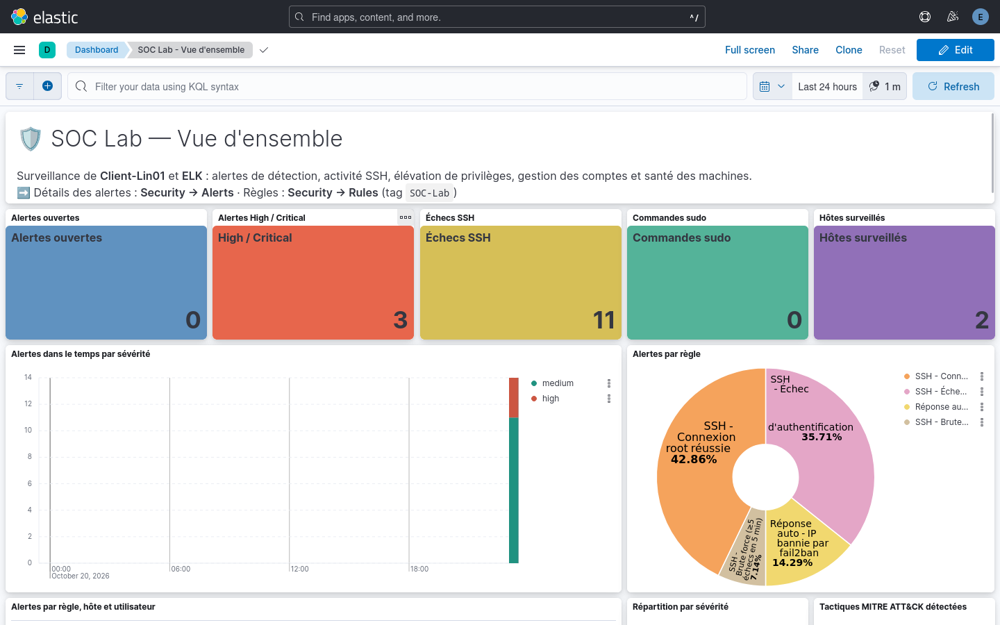
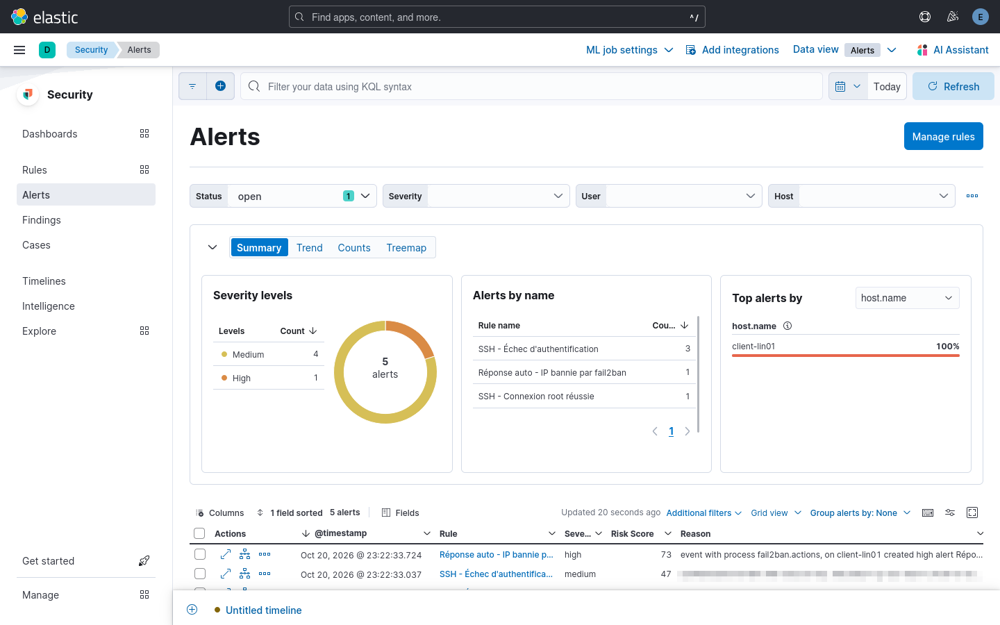
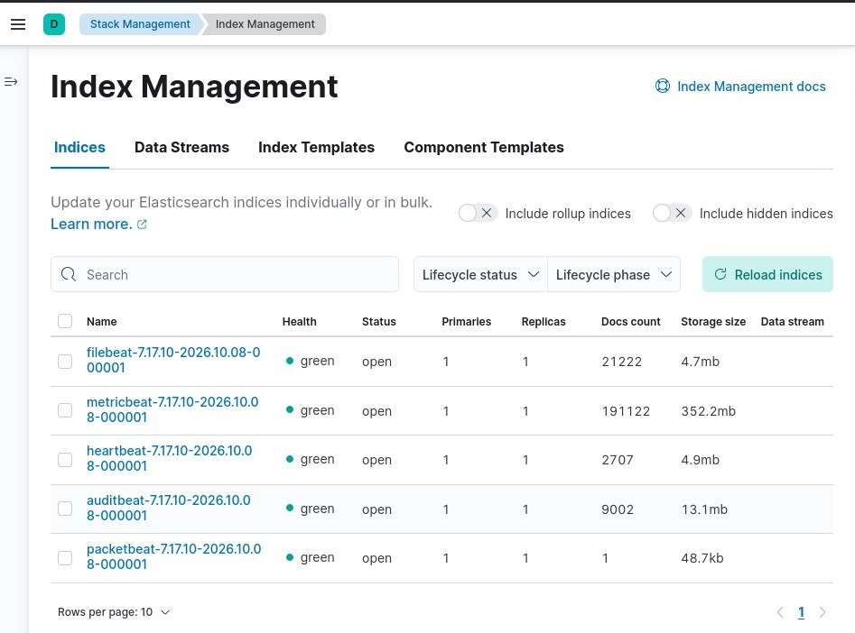
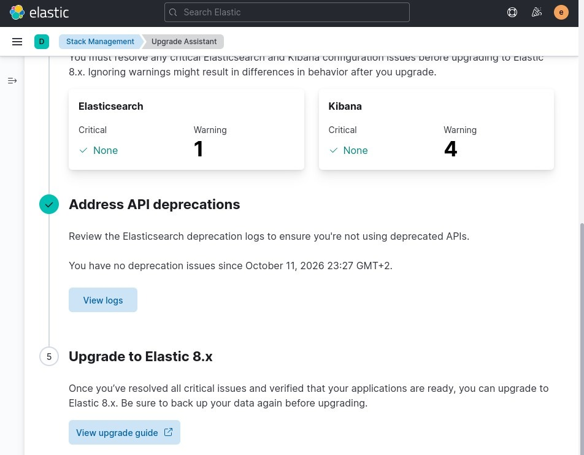
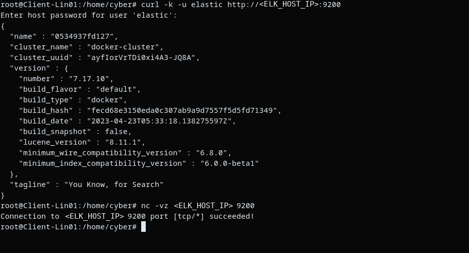
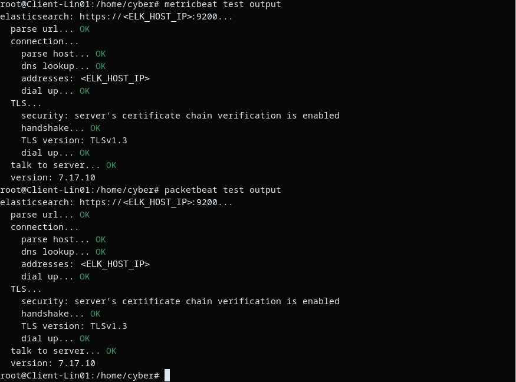
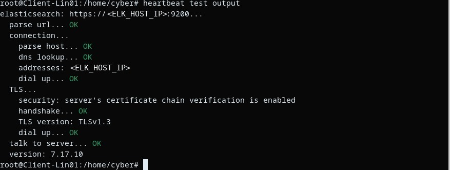

# 📸 Proof — Captures du projet

### SOC : détection & réponse

| | |
|:---:|:---:|
|  |  |
| Alertes levées par une attaque SSH simulée | Les 8 règles de détection actives |
|  |  |
| Cases ouverts automatiquement par SOC-IR | Case avec son playbook et ses alertes |

### Kibana & Fleet

| | |
|:---:|:---:|
|  |  |
| Accueil Kibana | Connexion avec authentification |
|  |  |
| Agents enrôlés dans Fleet | Jetons d'enrôlement (secrets floutés) |
|  |  |
| Index en `green` avec réplicas sur 2 nœuds | Upgrade Assistant avant le passage en v8 |

### Validation

| | |
|:---:|:---:|
|  |  |
| Requête refusée sans identifiants | Auditbeat / Filebeat en TLS 1.3 |
|  |  |
| Metricbeat / Packetbeat | Heartbeat |

Détail par dossier : [soc/](soc/) · [kibana/](kibana/) · [validation/](validation/) · ⬅️ [Retour au README](../README.md)
