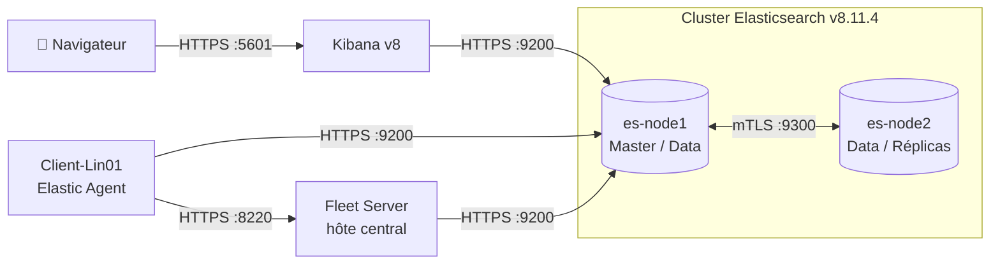

<div align="center">

# 🛡️ Elastic Stack — Security Hardening

**Durcissement et migration d'une Elastic Stack v7 mono-nœud vers un cluster distribué v8.11.4 chiffré de bout en bout**


[Architecture](docs/architecture.md) · [Hardening](docs/security-hardening.md) · [Certificats](docs/certificates.md) · [Sauvegarde](docs/backup-restore.md) · [Phases](#-feuille-de-route--9-phases)

</div>

---

## 📌 Présentation

Ce projet documente la **sécurisation complète** (*Security Hardening*) et la **migration** d'une infrastructure Elastic Stack d'une topologie v7 standard vers une **architecture distribuée v8.11.4 de niveau production**.

Mené comme un *Security Hardening Lab*, il applique trois principes : **moindre privilège**, **chiffrement systématique des flux** et **centralisation de la télémétrie**. Chaque étape est documentée, testée et accompagnée de ses incidents réels et de leur résolution.

## 🎯 Objectifs & résultats

| Objectif | Résultat |
|---|---|
| 🔒 **Zéro flux en clair** | HTTPS/TLS sur toutes les API, **mTLS** entre nœuds, CA racine interne |
| ⚙️ **Haute disponibilité** | Cluster 2 nœuds avec réplication, panne d'un nœud de données testée sans perte de données |
| 📡 **Modernisation SecOps** | Beats remplacés par **Elastic Agent + Fleet Server**, clés d'API rotatives |
| 🔄 **Cycle de vie maîtrisé** | Montée de version **v7 ➔ v8** sans perte de données ni rupture de collecte |

## 🏗️ Architecture



➡️ Détails : [docs/architecture.md](docs/architecture.md)

## 🔐 Matrice de sécurité

| Flux | Port | Protocole | Authentification & confiance |
|---|---|---|---|
| API Elasticsearch | 9200 | HTTPS | Certificat signé par la CA interne + authentification obligatoire |
| Transport inter-nœuds | 9300 | mTLS | `verification_mode: certificate`, CA partagée |
| Kibana | 5601 | HTTPS | Compte restreint `kibana_system` + TLS navigateur |
| Enrôlement Fleet Server | 8220 | HTTPS | Service token Elasticsearch v8 |
| Agents ➔ Fleet | 8220 | HTTPS | Clés d'API rotatives générées par Fleet |

➡️ Détails : [docs/security-hardening.md](docs/security-hardening.md)

## 🗺️ Feuille de route : 9 phases

| Phase | Étape | Point clé |
|:---:|---|---|
| 00 | [Stabilisation](phases/phase-00-stabilization.md) | Résolution d'une `UnavailableShardsException` sur `.security` |
| 01 | [Authentification](phases/phase-01-authentication.md) | Fin des accès anonymes, moindre privilège, audit |
| 02 | [TLS HTTP](phases/phase-02-http-tls.md) | API REST en HTTPS via une CA interne |
| 03 | [TLS Transport](phases/phase-03-transport-tls.md) | mTLS entre les nœuds |
| 04 | [Kibana HTTPS](phases/phase-04-kibana-https.md) | HTTPS navigateur + compte `kibana_system` |
| 05 | [Authentification des Beats](phases/phase-05-beats-authentication.md) | Comptes d'écriture dédiés, keystore |
| 06 | [Fleet](phases/phase-06-fleet.md) | Migration vers Elastic Agent + Fleet Server |
| 07 | [Cluster](phases/phase-07-cluster.md) | Ajout d'un 2ᵉ nœud, test de failover |
| 08 | [Upgrade v8](phases/phase-08-upgrade.md) | Rolling upgrade, mise à niveau des agents à distance |

## 📂 Structure du dépôt

```
├── docker-compose.yml        # Cluster 2 nœuds + Kibana, TLS activé
├── .env.example              # Modèle des variables (le .env réel n'est pas versionné)
├── docs/                     # Architecture, hardening, PKI, sauvegarde
├── config/
│   ├── elasticsearch/        # es-node1.yml, es-node2.yml, instances.yml (certificats)
│   ├── kibana/               # kibana.yml (HTTPS + Fleet)
│   └── beats/                # Configs historiques Filebeat / Metricbeat (phase 05)
├── scripts/                  # health-check.sh, verify-tls.sh
├── tests/                    # authentication/, tls/, ingestion/
├── screenshots/              # architecture/, kibana/, validation/
└── phases/                   # Journal détaillé des 9 phases
```

## 🚀 Démarrage rapide

```bash
# 1. Variables d'environnement
cp .env.example .env && nano .env

# 2. PKI interne : CA + certificats (voir docs/certificates.md)

# 3. Lancement du cluster et de Kibana
set -a; . ./.env; set +a
docker compose up -d

# 4. Vérifications
./scripts/health-check.sh
./scripts/verify-tls.sh
```

Le déploiement du Fleet Server et l'enrôlement des agents sont décrits en [phase 06](phases/phase-06-fleet.md).

## 🧪 Validation

| Domaine | Ce qui est vérifié | Script |
|---|---|---|
| Authentification | Rejet des requêtes anonymes ou mal signées, moindre privilège | [`test-authentication.sh`](tests/authentication/test-authentication.sh) |
| TLS | Chaîne de confiance, rejet d'une CA inconnue (anti-MitM), protocoles obsolètes refusés | [`test-tls.sh`](tests/tls/test-tls.sh) |
| Ingestion | Écriture/lecture de bout en bout, flux des agents | [`test-ingestion.sh`](tests/ingestion/test-ingestion.sh) |
| Résilience | Perte du nœud secondaire sans interruption | [Phase 07](phases/phase-07-cluster.md#test-de-résilience-failover) |

## 🛠️ Post-mortem : incidents résolus

| Incident | Cause | Résolution |
|---|---|---|
| 🔴 `UnavailableShardsException` sur `.security` | Réplicas impossibles à allouer sur un nœud unique | Réplicas système à 0 puis réintégration à chaud du 2ᵉ nœud — [phase 00](phases/phase-00-stabilization.md) |
| 🔴 Agent `DEGRADED` après la v8 | Restriction v8 sur les chemins de CA par défaut | Lien symbolique vers `/etc/elastic-agent/certs/elk-ca.crt` — [phase 08](phases/phase-08-upgrade.md) |
| 🔴 Conflits inter-versions | Agents v7 face à un Fleet v8 | Upgrade des agents à distance depuis Kibana — [phase 08](phases/phase-08-upgrade.md) |

## 📸 Captures

Les preuves visuelles (Kibana, Fleet, tests) sont regroupées dans [`screenshots/`](screenshots/).

## 🧠 Compétences mises en œuvre

`Elasticsearch` `Kibana` `Fleet` `Elastic Agent` `Beats` `Docker Compose` `PKI / X.509` `TLS / mTLS` `OpenSSL` `Bash` `Linux` `Haute disponibilité` `Gestion des montées de version` `Analyse d'incidents`

---

<div align="center">

📄 Licence [MIT](LICENSE) · Réalisé par **[CodjoH](https://github.com/CodjoH)**

</div>
