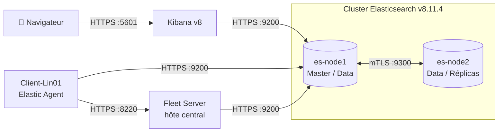
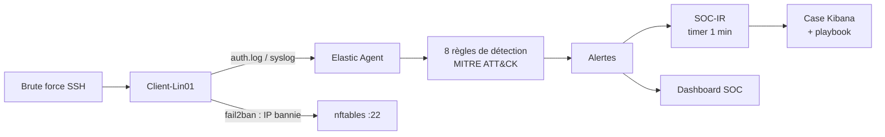
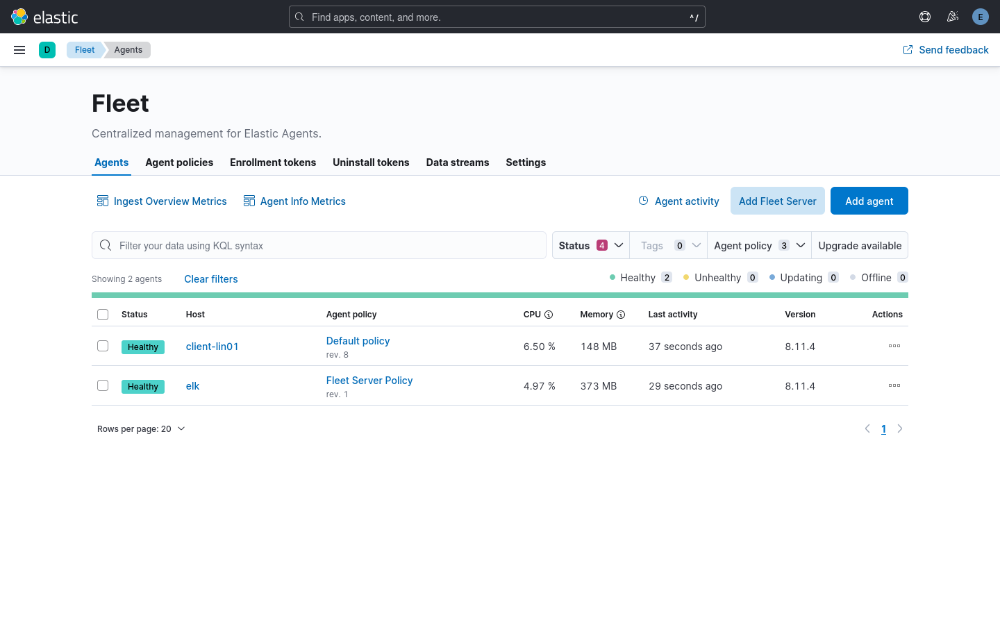
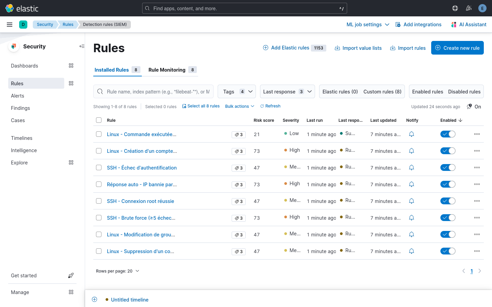

<div align="center">


# 🛡️ Elastic Stack — Secure Observability Platform

**Conception et déploiement d'une plateforme d'observabilité sécurisée basée sur Elastic Stack 8.11, intégrant la centralisation des logs, la détection des menaces à l'aide de règles alignées sur MITRE ATT&CK et la réponse automatisée aux incidents.**

`Elastic Stack 8.11.4` · `Kibana` · `Fleet / Elastic Agent` · `Docker Compose` · `TLS / mTLS` · `MITRE ATT&CK` · `Python` · `Licence MIT`

[Architecture](docs/architecture.md) · [Hardening](docs/security-hardening.md) · [Certificats](docs/certificates.md) · [Sauvegarde](docs/backup-restore.md) · [Détection](detection/README.md) · [Playbooks](docs/playbooks/README.md) · [Phases](phases/) · [Visualisation](#-visualisation) · [Proof](Proof/)

</div>

---

## 📌 Présentation

Ce projet présente la sécurisation complète et la migration d'une infrastructure Elastic Stack, d'un nœud unique en version 7.17 vers un cluster distribué en version 8.11.4.

Trois principes ont guidé le travail : moindre privilège, chiffrement de tous les flux et centralisation de la télémétrie. Chaque étape est documentée et testée, avec les incidents rencontrés et leur résolution.

Une fois sécurisée, la plateforme a été exploitée comme un SOC : règles de détection versionnées et alignées sur MITRE ATT&CK, tableau de bord d'analyse, confinement automatique des attaques SSH et ouverture de Cases accompagnés de leur playbook.

## 🎯 Objectifs

- 🔐 Sécuriser l'accès à Kibana et Elasticsearch : authentification obligatoire et moindre privilège.
- 🔒 Chiffrer les communications HTTP et transport avec TLS et mTLS.
- 🪪 Mettre en place une PKI interne : autorité de certification et certificats vérifiés.
- 📊 Maintenir la collecte et l'ingestion des événements à chaque évolution.
- ⚙️ Déployer Fleet Server et migrer les Beats vers Elastic Agent.
- 🏗️ Passer à un cluster Elasticsearch à deux nœuds et en tester la résilience.
- 🔄 Préparer, réaliser et documenter la montée de version de la 7.17 à la 8.11.
- 🚨 Détecter les menaces avec des règles alignées sur MITRE ATT&CK.
- 🛡️ Automatiser la réponse aux incidents : confinement, Cases et playbooks.

---

## 🏗️ Architecture



➡️ Détails : [docs/architecture.md](docs/architecture.md)

## 🔐 Matrice de sécurité

| Flux | Port | Protocole | Authentification & confiance |
|---|---|---|---|
| API Elasticsearch | 9200 | HTTPS | Certificat signé par la CA interne + authentification obligatoire |
| Transport inter-nœuds | 9300 | mTLS | `verification_mode: certificate`, CA partagée |
| Kibana | 5601 | HTTPS | Compte restreint `kibana_system` + TLS navigateur |
| Enrôlement Fleet Server | 8220 | HTTPS | Service token Elasticsearch v8 |
| Agents ➔ Fleet | 8220 | HTTPS | Clés d'API rotatives générées par Fleet |

➡️ Détails : [docs/security-hardening.md](docs/security-hardening.md)

## 🚨 Détection & réponse à incident



---

## 📂 Structure du dépôt

```
├── docker-compose.yml        # Cluster 2 nœuds + Kibana, TLS activé
├── .env.example              # Modèle des variables (le .env réel n'est pas versionné)
├── docs/                     # Architecture, hardening, PKI, sauvegarde
├── config/
│   ├── elasticsearch/        # instances.yml (certificats)
│   ├── kibana/               # Paramètres Kibana (HTTPS + Fleet)
│   └── beats/                # filebeat.yml, rôle d'écriture des Beats (phase 05)
├── detection/rules/          # Règles de détection (JSON, une par fichier)
├── dashboards/               # Export NDJSON du dashboard SOC
├── response/
│   ├── fail2ban/             # Confinement automatique des brute force SSH
│   └── soc-ir/               # Service de création des Cases + unités systemd
├── docs/playbooks/           # Un playbook de réponse par règle
├── scripts/                  # health-check, verify-tls, deploy-rules, build-dashboard
├── tests/                    # authentication/, tls/, ingestion/, detection/, response/
├── Proof/                    # Captures : architecture/, kibana/, validation/, soc/
└── phases/                   # Journal détaillé des 13 phases
```

## 🚀 Déploiement & validation

**Prérequis :** Docker + Compose, OpenSSL, hôte Linux avec 8 Go de RAM minimum.

| # | Étape | Ce qui est vérifié | Preuve |
|:---:|---|---|---|
| 1 | 🪪 PKI interne (CA, HTTPS, transport mTLS) | CA inconnue rejetée (anti-MitM), protocoles obsolètes refusés | [`test-tls.sh`](tests/tls/test-tls.sh) |
| 2 | 🔐 Secrets dans `.env` (jamais versionné) | Requêtes anonymes rejetées, moindre privilège | [`test-authentication.sh`](tests/authentication/test-authentication.sh) |
| 3 | 🐳 Cluster 2 nœuds + Kibana | Perte d'un nœud sans interruption | [Phase 07](phases/phase-07-cluster.md#test-de-résilience-failover) |
| 4 | ⚙️ Fleet Server et agents | Ingestion de bout en bout | [`test-ingestion.sh`](tests/ingestion/test-ingestion.sh) |
| 5 | 🚨 Analyse, corrélation & réponse aux incidents | Brute force : IP bannie, alertes, Cases ouverts avec playbook | [`simulate-attacks.sh`](tests/detection/simulate-attacks.sh) · [`test_soc_ir.py`](tests/response/test_soc_ir.py) |

```bash
cp .env.example .env && set -a; . ./.env; set +a
docker compose up -d
./scripts/health-check.sh && ./scripts/verify-tls.sh
./scripts/deploy-rules.py && ./scripts/build-dashboard.py
sudo -E ./response/soc-ir/install.sh
```

---

## 📸 Visualisation

🔹 Fleet : serveur ELK et client en `Healthy`, version 8.11.4



🔹 Les 8 règles de détection actives



🔹 Cases ouverts automatiquement par SOC-IR


🔗 Toutes les captures (SOC : détection & réponse, Kibana & Fleet, Validation) : [**Proof**](Proof/)

---

## 🛠️ Problèmes rencontrés

| Incident | Cause | Résolution |
|---|---|---|
| 🔴 `UnavailableShardsException` sur `.security` | Réplicas impossibles à allouer sur un nœud unique | Réplicas système à 0 puis réintégration à chaud du 2ᵉ nœud ([phase 00](phases/phase-00-stabilization.md)) |
| 🔴 Agent `DEGRADED` après la v8 | Restriction v8 sur les chemins de CA par défaut | Lien symbolique vers `/etc/elastic-agent/certs/elk-ca.crt` ([phase 08](phases/phase-08-upgrade.md)) |
| 🔴 Conflits inter-versions | Agents v7 face à un Fleet v8 | Upgrade des agents à distance depuis Kibana ([phase 08](phases/phase-08-upgrade.md)) |
| 🔴 Agent 8.0 Unhealthy, upgrade impossible | Timeout de téléchargement de 120 s, puis paquet local effacé par l'agent 8.0 | Réinstallation propre en 8.11.4 + réaffectation de policy ([phase 09](phases/phase-09-fleet-troubleshooting.md)) |
| 🟠 Aucun log d'authentification | Debian 12 n'écrit plus `/var/log/auth.log` (journald seul) | rsyslog au format classique ([phase 10](phases/phase-10-detection-engineering.md)) |
| 🟠 Règles qui ne déclenchent jamais | Le pipeline System 1.53 ne remplit pas `event.category: iam` / `process.name` | Requêtes réécrites sur les champs réellement indexés ([phase 10](phases/phase-10-detection-engineering.md)) |
| 🟠 Pas de Case automatique en licence basic | Connecteur Cases indisponible | Service SOC-IR via l'API Cases ([phase 12](phases/phase-12-incident-response.md)) |

## 🏆 Résultats

<p align="center">
  
</p>

---

## 🔗 Documentation

- 📖 [Elasticsearch — sécurité et TLS](https://www.elastic.co/docs/deploy-manage/security/secure-cluster-communications)
- 📖 [Fleet & Elastic Agent](https://www.elastic.co/docs/reference/fleet/install-fleet-managed-elastic-agent)
- 📖 [Elastic Security — détection et alertes](https://www.elastic.co/docs/solutions/security/detect-and-alert)
- 📖 [Kibana — API Cases](https://www.elastic.co/docs/api/doc/kibana/group/endpoint-cases)
- 📖 [MITRE ATT&CK](https://attack.mitre.org/)

---

<div align="center">

<p align="center">
  🛡️ <strong>Hubert Codjo</strong><br>
  <sub>Cybersecurity Engineer • SOC Analyst • Blue Team</sub><br><br>
  📧 <a href="mailto:houet.hubert@gmail.com"><strong>Click to contact me</strong></a><br><br>
  ─ · ─<br><br>
</p>


</div>
