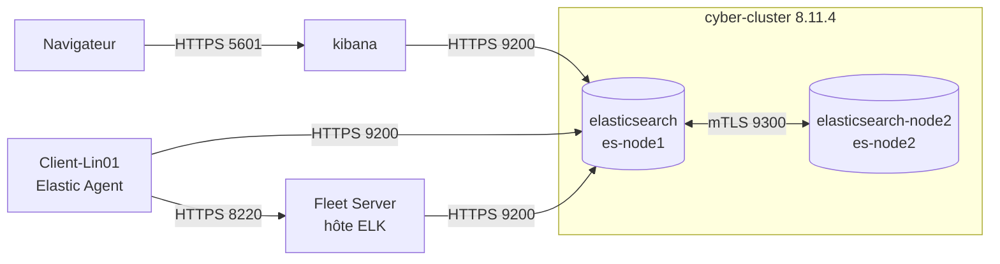

# Elastic Stack : Security Hardening


Déploiement d'une Elastic Stack **7.17.10** mono-nœud sous Docker, puis durcissement et évolution par étapes jusqu'à un cluster **8.11.4** à deux nœuds, chiffré sur tous les flux, avec une collecte gérée par Fleet.

Au départ : pas d'authentification, tout en HTTP, et cinq Beats configurés à la main sur la machine cliente. L'objectif était d'en faire une plateforme exploitable en documentant chaque étape et chaque problème rencontré.

## Résultat

- **aucun flux en clair** : HTTPS sur 9200, 5601 et 8220, mTLS entre les nœuds sur 9300, certificats signés par une CA interne
- **authentification obligatoire**, Kibana connecté avec `kibana_system`, Fleet Server avec un service token
- **deux nœuds** avec réplicas, arrêt du second nœud testé sans perte de données
- **Elastic Agent + Fleet** à la place de Filebeat, Metricbeat, Auditbeat, Heartbeat et Packetbeat
- **montée de version 7.17.10 → 8.11.4** sans perte de données ni coupure de la collecte


## Architecture



Détails : [docs/architecture.md](docs/architecture.md) · compose : [docker-compose.yml](docker-compose.yml)

| Flux | Port | Protection |
|---|---|---|
| API Elasticsearch | 9200 | HTTPS, certificat de la CA interne, authentification obligatoire |
| Transport entre nœuds | 9300 | TLS mutuel, `verification_mode: certificate` |
| Kibana | 5601 | HTTPS, Kibana connecté avec `kibana_system` |
| Fleet Server | 8220 | HTTPS, service token |
| Agents vers Fleet | 8220 | HTTPS, clés d'API générées par Fleet |

## Étapes

| Phase | Version | Contenu |
|---|---|---|
| [00](phases/phase-00-stabilization.md) | 7.17.10 | déploiement initial mono-nœud |
| [01](phases/phase-01-authentication.md) | 7.17.10 | activation de la sécurité, comptes intégrés |
| [02](phases/phase-02-http-tls.md) | 7.17.10 | CA interne, HTTPS sur l'API |
| [03](phases/phase-03-transport-tls.md) | 7.17.10 | TLS mutuel entre les nœuds |
| [04](phases/phase-04-kibana-https.md) | 7.17.10 | Kibana en HTTPS |
| [05](phases/phase-05-beats-authentication.md) | 7.17.10 | les 5 Beats en HTTPS avec authentification |
| [06](phases/phase-06-fleet.md) | 7.17.10 | migration vers Elastic Agent + Fleet |
| [07](phases/phase-07-cluster.md) | 7.17.10 | second nœud, incident `.security`, test de panne |
| [08](phases/phase-08-upgrade.md) | 7.17.10 → 8.11.4 | montée de version, incidents agents |

## Problèmes rencontrés

| Problème | Cause | Solution |
|---|---|---|
| `UnavailableShardsException` sur `.security` | index système indisponible après la réorganisation réseau | réplicas système à 0, puis ajout à chaud du second nœud ([phase 07](phases/phase-07-cluster.md)) |
| agent local en `DEGRADED` après le passage en 8 | restriction 8.x sur les chemins de CA par défaut | lien symbolique vers `/etc/elastic-agent/certs/elk-ca.crt` ([phase 08](phases/phase-08-upgrade.md)) |
| erreurs entre agents 7.x et Fleet 8.x | versions mélangées pendant la transition | mise à jour des agents à distance depuis Fleet ([phase 08](phases/phase-08-upgrade.md)) |

## Quelques preuves

| | |
|---|---|
| Beats en TLS 1.3 avec vérification de la chaîne |  |
| Index en `green` avec 1 réplica sur 2 nœuds |  |

Toutes les captures : [screenshots/](screenshots/)

## Contenu du dépôt

```
docker-compose.yml     cluster 2 nœuds + Kibana (état final, chemins et secrets en variables)
.env.example           variables à renseigner (le .env n'est pas versionné)
config/                paramètres Elasticsearch / Kibana, sortie des Beats
docs/                  architecture, durcissement, certificats, sauvegarde
phases/                détail de chaque étape
scripts/               health-check.sh, verify-tls.sh
tests/                 authentification, TLS, ingestion
screenshots/           captures prises pendant le projet
```

## Lancer

```bash
cp .env.example .env          # mots de passe, CERTS_DIR, SNAPSHOTS_DIR, ELK_HOST
# CA et certificats : docs/certificates.md
docker compose up -d
bash scripts/health-check.sh
bash scripts/verify-tls.sh
```

Fleet Server et agents : [phase 06](phases/phase-06-fleet.md).

## Tests

| Script | Vérifie |
|---|---|
| [test-authentication.sh](tests/authentication/test-authentication.sh) | 401 sans identifiants ou avec un mauvais mot de passe, droits limités de `kibana_system` |
| [test-tls.sh](tests/tls/test-tls.sh) | certificat validé par la CA interne, refusé sans elle, TLS 1.1 refusé |
| [test-ingestion.sh](tests/ingestion/test-ingestion.sh) | écriture / lecture, données récentes des agents |

## Confidentialité

Les adresses IP, mots de passe, tokens et chemins locaux sont remplacés par des variables (`<ELK_HOST>`, `CERTS_DIR`…). Sur les captures, les IP sont remplacées et les secrets des jetons d'enrôlement floutés. Aucun certificat ni clé n'est versionné.

## Outils

Elasticsearch, Kibana, Fleet, Elastic Agent, Beats, Docker Compose, OpenSSL, Bash, Linux

---

Licence [MIT](LICENSE)
