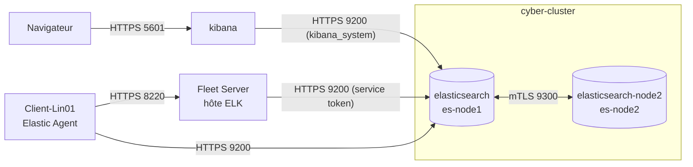

# Architecture

## Point de départ

Elastic Stack **7.17.10** sous Docker, un seul nœud (`docker-cluster`), sans authentification ni TLS. Sur la machine cliente Client-Lin01, cinq Beats envoyaient directement vers Elasticsearch : Filebeat, Metricbeat, Auditbeat, Heartbeat et Packetbeat.

## Architecture finale (8.11.4)

| Conteneur / hôte | Nœud | Rôle | Ports |
|---|---|---|---|
| `elasticsearch` | es-node1 | master-eligible, data | 9200 publié sur l'hôte, 9300 |
| `elasticsearch-node2` | es-node2 | master-eligible, data | 9300 (réseau Docker uniquement) |
| `kibana` | | interface, console Fleet | 5601 |
| hôte ELK | | Fleet Server (installé hors Docker) | 8220 |
| Client-Lin01 | | Elastic Agent | sortant uniquement |

Compose complet : [docker-compose.yml](../docker-compose.yml). Les IP ne sont pas publiées, l'hôte central est noté `<ELK_HOST>`.

## Avant / après

| | 7.17.10 | 8.11.4 |
|---|---|---|
| Nœuds | 1 | 2 |
| Authentification | désactivée | obligatoire |
| Chiffrement | aucun | HTTPS sur 9200 / 5601 / 8220, mTLS sur 9300 |
| Collecte | 5 Beats configurés à la main | Elastic Agent géré par Fleet |
| Mise à jour des agents | manuelle | depuis Kibana |
| Réplicas | 0 | 1 |

## Limite connue

Avec deux nœuds master-eligible, Elasticsearch ne garde qu'un seul des deux dans la configuration de vote (il faut un nombre impair). Si c'est ce nœud qui tombe, plus aucun master ne peut être élu. Les données sont répliquées, mais la disponibilité du cluster n'est pas garantie dans tous les cas. Il faudrait un troisième nœud, même `voting_only`, pour ça.
