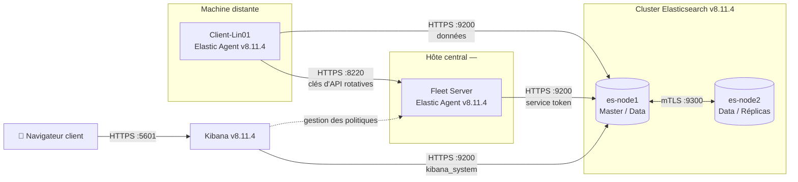

# 🏗️ Architecture

## Vue d'ensemble

La plateforme réunit un **cluster Elasticsearch distribué**, une interface **Kibana** et une flotte d'agents pilotée par un **Fleet Server** natif. Chaque flux réseau est chiffré.

## Composants

| Composant | Rôle | Déploiement | Ports |
|---|---|---|---|
| `es-node1` | Nœud maître éligible, données, ingestion | Docker | 9200 (HTTPS), 9300 (mTLS) |
| `es-node2` | Nœud de données, porteur des réplicas | Docker | 9300 (mTLS) |
| Kibana | Visualisation, administration, console Fleet | Docker | 5601 (HTTPS) |
| Fleet Server | Enrôlement et pilotage centralisé des agents | Bare-metal (hôte central) | 8220 (HTTPS) |
| Elastic Agent | Collecte des logs et métriques (`Client-Lin01`) | Bare-metal (client) | sortant uniquement |

## Évolution de la topologie

| | Avant (v7) | Après (v8.11.4) |
|---|---|---|
| Topologie | Nœud unique | Cluster 2 nœuds |
| Chiffrement | Aucun / partiel | HTTPS + mTLS sur tous les flux |
| Authentification | Optionnelle | Obligatoire, comptes à privilèges minimaux |
| Collecte | Beats installés et configurés un par un | Elastic Agent piloté par Fleet |
| Mises à jour des agents | Manuelles, machine par machine | À distance depuis Kibana |
| Tolérance aux pannes | Aucune | Réplication des shards entre nœuds |

## Principes de conception

1. **Zéro flux en clair** — aucun port n'accepte de connexion non chiffrée.
2. **Moindre privilège** — chaque composant utilise un compte ou un jeton limité à son besoin (`kibana_system`, service token `elastic/fleet-server`, clés d'API Fleet).
3. **Chaîne de confiance unique** — une CA racine interne signe tous les certificats (voir [certificates.md](certificates.md)).
4. **Centralisation** — politiques de collecte définies une fois dans Fleet et appliquées à toute la flotte.
