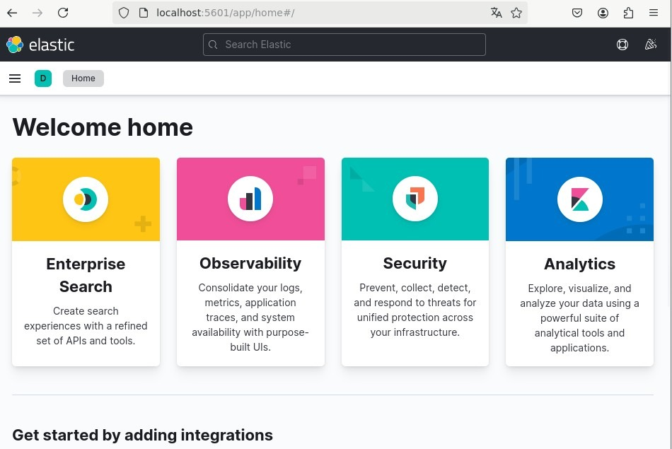

# Phase 00 : déploiement initial et stabilisation (7.17.10)

## Point de départ

Elastic Stack 7.17.10 sur un seul nœud avec Docker Compose :

- Elasticsearch et Kibana, sécurité désactivée
- API et interface en HTTP
- sur Client-Lin01 : Filebeat, Metricbeat, Auditbeat, Heartbeat et Packetbeat, envoi direct vers Elasticsearch

Avant de durcir quoi que ce soit, je voulais une base stable et connue.

## Prérequis système

```bash
# obligatoire pour Elasticsearch
sudo sysctl -w vm.max_map_count=262144
echo "vm.max_map_count=262144" | sudo tee /etc/sysctl.d/99-elasticsearch.conf
```

Dans le compose : `memlock` illimité, `nofile` à 65536, heap fixé via `ES_JAVA_OPTS`.

## Contrôles

```bash
curl -s "http://localhost:9200/_cluster/health?pretty"
curl -s "http://localhost:9200/_cat/indices?v"
curl -s "http://localhost:9200/_cat/shards?v&h=index,shard,prirep,state,unassigned.reason"
```

En mono-nœud, les index avec un réplica restent en `yellow` (un réplica ne peut pas être sur le même nœud que son primaire). Pour les index créés à ce stade, réplicas à 0 :

```bash
curl -X PUT "http://localhost:9200/_all/_settings" -H 'Content-Type: application/json' \
  -d '{"index":{"number_of_replicas":0}}'
```

Ils sont remis à 1 en [phase 07](phase-07-cluster.md) quand le deuxième nœud arrive.

## État en fin de phase

Cluster `green`, Kibana accessible, données des Beats visibles dans Discover. Tout est encore en clair et sans authentification : Kibana s'ouvre directement, sans écran de connexion ni menu utilisateur.



Suite : [phase 01](phase-01-authentication.md)
