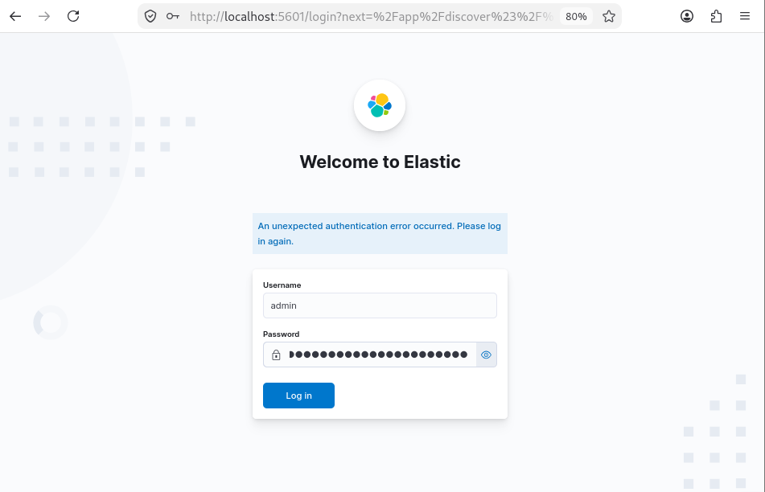

# Phase 01 : authentification

Objectif : plus aucun accès sans identifiants.

## Configuration

```yaml
xpack.security.enabled: true
discovery.type: single-node
```

En 7.17, activer la sécurité sur un cluster multi-nœuds impose aussi le TLS transport. Tant que le cluster est en `single-node`, ce n'est pas encore obligatoire, ce qui permet de séparer les étapes (le transport est traité en [phase 03](phase-03-transport-tls.md)).

## Mots de passe des comptes intégrés

En 7.17 :

```bash
docker exec -it elasticsearch bin/elasticsearch-setup-passwords interactive
```

(En 8.x la commande devient `elasticsearch-reset-password -u <compte>`.)

Les mots de passe vont dans le `.env`, pas dans les fichiers de configuration.

## Qui utilise quoi

| Compte | Utilisation |
|---|---|
| `elastic` | administration uniquement |
| `kibana_system` | connexion Kibana vers Elasticsearch |
| comptes `*_writer` | écriture des Beats ([phase 05](phase-05-beats-authentication.md)) |

## Vérification

```bash
curl -s -o /dev/null -w "%{http_code}\n" http://localhost:9200/                       # 401
curl -s -o /dev/null -w "%{http_code}\n" -u elastic:mauvais http://localhost:9200/   # 401
curl -s -u elastic:$ELASTIC_PASSWORD http://localhost:9200/                           # 200
```

Depuis Client-Lin01, l'API répond seulement après saisie du mot de passe :


Côté Kibana, l'écran de connexion apparaît. Les sessions ouvertes avant l'activation ne sont plus valides, d'où le message d'erreur au premier retour sur la page :



Ces deux captures montrent aussi le problème restant : l'URL est en `http://`. Le mot de passe saisi passe en clair sur le réseau (Basic Auth = base64), d'où la phase suivante.

Une fois le TLS en place, ces contrôles sont regroupés dans [test-authentication.sh](../tests/authentication/test-authentication.sh).

Suite : [phase 02](phase-02-http-tls.md)
