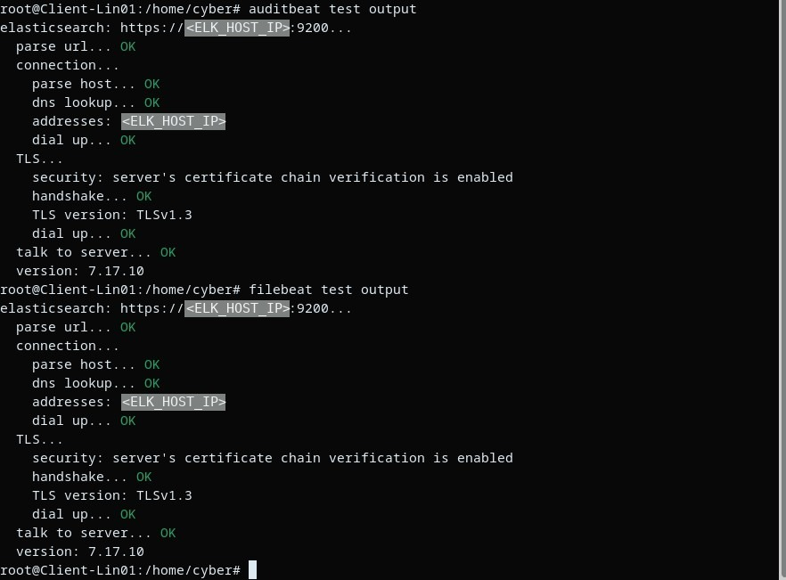

# Phase 05 : Beats en HTTPS et authentifiés

Après les phases 01 à 04, les cinq Beats de Client-Lin01 (Filebeat, Metricbeat, Auditbeat, Heartbeat, Packetbeat) ne pouvaient plus écrire : il leur fallait des identifiants et la CA.

## Rôle d'écriture

[beats-writer-role.json](../config/beats/beats-writer-role.json) : création de documents uniquement, sur les index des cinq Beats.

```bash
C="curl --cacert $CERTS_DIR/ca/ca.crt -u elastic:$ELASTIC_PASSWORD -H Content-Type:application/json"
$C -X PUT "https://<ELK_HOST>:9200/_security/role/beats_writer" -d @config/beats/beats-writer-role.json
$C -X PUT "https://<ELK_HOST>:9200/_security/user/<utilisateur>" -d '{"password":"<mot_de_passe>","roles":["beats_writer"]}'
```

## Configuration

Même bloc de sortie pour les cinq Beats ([exemple](../config/beats/filebeat.yml)) : `https://`, CA interne copiée sur le client, `ssl.verification_mode: full`. Le mot de passe est dans le keystore du Beat :

```bash
sudo filebeat keystore create
sudo filebeat keystore add ES_PWD
```

## Vérification

`test output` sur chaque Beat : connexion OK, chaîne de certificats vérifiée, TLS 1.3, Elasticsearch 7.17.10.





## Limites

Ça fonctionne, mais cinq agents différents, chacun avec sa configuration, son keystore et ses mises à jour, sur une seule machine. À l'échelle de plusieurs postes, ce n'est pas tenable. C'est ce qui a motivé le passage à Fleet.

Suite : [phase 06](phase-06-fleet.md)
