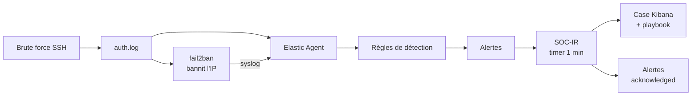
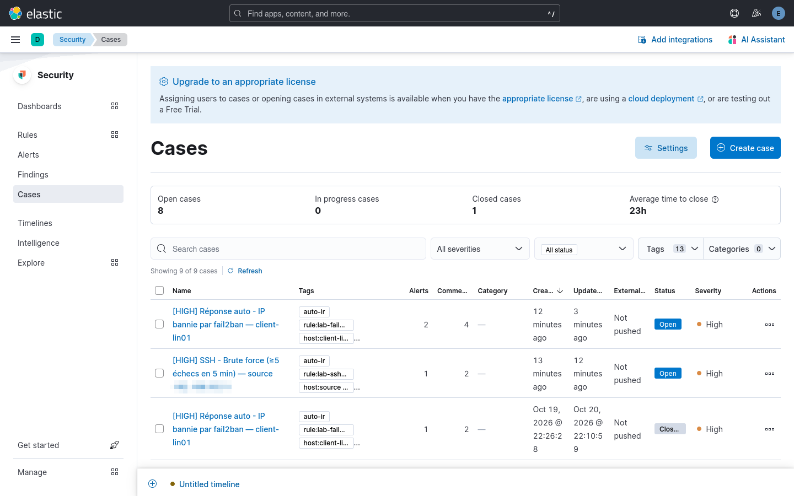
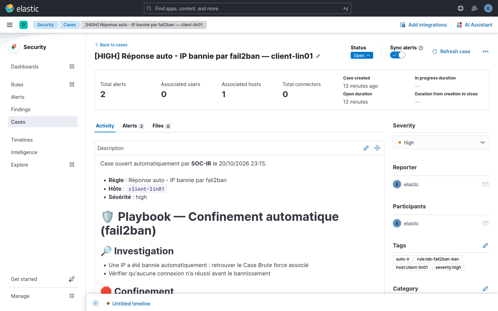

# Phase 12 : réponse à incident

Détecter ne suffit pas : cette phase ajoute un **confinement automatique** sur l'hôte et un **workflow d'investigation** dans Kibana.



## Confinement automatique : fail2ban

Sur le client, 5 échecs SSH en 10 minutes depuis une même IP entraînent un bannissement d'1 heure, appliqué par nftables sur le port 22 uniquement (le trafic de l'agent vers Fleet n'est pas touché). Configuration : [response/fail2ban/](../response/fail2ban).

```bash
sudo apt-get install -y fail2ban
sudo cp response/fail2ban/jail.local response/fail2ban/fail2ban.local /etc/fail2ban/
sudo sed -i 's/<ADMIN_IP>/<IP_ADMIN>/' /etc/fail2ban/jail.local   # poste d'administration
sudo systemctl restart fail2ban
sudo fail2ban-client status sshd
```

Après une attaque simulée depuis l'hôte central :

```
$ sudo fail2ban-client status sshd
Status for the jail: sshd
|- Filter
|  |- Currently failed:	1
|  |- Total failed:	22
|  `- File list:	/var/log/auth.log
`- Actions
   |- Currently banned:	1
   |- Total banned:	3
   `- Banned IP list:	<IP_ATTAQUANT>

$ sudo nft list set inet f2b-table addr-set-sshd
table inet f2b-table {
	set addr-set-sshd {
		type ipv4_addr
		elements = { <IP_ATTAQUANT> }
	}
}
```

Le poste d'administration est en `ignoreip` pour ne jamais se couper l'accès : ses échecs restent détectés par ELK, mais il n'est pas banni. fail2ban journalise dans syslog, chaque bannissement remonte donc dans ELK et déclenche la règle *Réponse auto - IP bannie par fail2ban*.

## Workflow d'investigation : SOC-IR

En licence *basic*, une règle ne peut pas ouvrir un Case elle-même (le connecteur Cases n'existe pas dans cette version). [SOC-IR](../response/soc-ir/soc-ir.py) fait le lien, chaque minute, sur l'hôte central :

1. récupère les alertes `open` de sévérité medium et plus ;
2. les regroupe par (règle, hôte) ; pour une règle à seuil sans hôte, par IP source ;
3. crée le Case, ou complète celui qui est déjà ouvert, avec le [playbook](../docs/playbooks) de la règle en description ;
4. passe les alertes en `acknowledged`, **avant** de les rattacher, pour ne jamais les traiter deux fois ;
5. ajoute un commentaire de synthèse : période, IP, comptes, extraits de logs.

Les alertes sont synchronisées avec le Case : le fermer ferme ses alertes. Si la même règle se déclenche ensuite sur le même hôte, un nouveau Case est ouvert.

```bash
set -a; . ./.env; set +a
sudo -E ./response/soc-ir/install.sh        # script, playbooks, CA, clé API, timer systemd
systemctl list-timers soc-ir.timer
tail -f /var/log/soc-ir.log
```

La clé API vient d'un compte dédié (Stack Management > API keys), stockée en `0600` dans `/etc/soc-ir/apikey`, jamais versionnée. Le TLS est vérifié avec la CA interne, et le service tourne avec `ProtectSystem=strict`.

## Incident : conflit 409

Premier cycle en erreur : `HTTP Error 409: Conflict` au passage en `acknowledged`. Le moteur de règles écrivait sur les mêmes alertes au même moment. Le cycle suivant les avait déjà rattachées au Case, d'où un risque de doublon. Corrigé en trois points : acquittement **avant** rattachement, `conflicts: proceed`, et nouvel essai sur 409.

## Incident : horloge figée par la mise en pause de la VM

Après une mise en pause / reprise de la VM centrale, le scénario de test échouait : aucune alerte. L'horloge d'ELK retardait de **8 min 34 s** et son service NTP était inactif. Kibana calcule la fenêtre des règles (`now-2m`) avec sa propre horloge : les événements du client, horodatés correctement, étaient « dans le futur » et ignorés. La charge de la VM (load ~6 pour 4 vCPU) ajoutait 5 minutes de retard d'exécution aux règles.

```bash
sudo systemctl restart systemd-timesyncd   # resynchronisation immédiate (offset +8min34s)
sudo systemctl enable --now systemd-timesyncd && sudo timedatectl set-ntp true
```

Leçon : dans un SIEM, la synchronisation des horloges est une dépendance de la détection, pas un détail.

## fail2ban et règle « brute force » : qui agit en premier ?

En mode `aggressive`, fail2ban compte plusieurs lignes par tentative SSH (`Invalid user`, `Connection closed by invalid user`...) et bannit l'IP après ~3 tentatives. La règle à seuil d'ELK (≥ 5 échecs en 5 min) n'est alors souvent pas atteinte. C'est le comportement voulu : le confinement intervient avant l'escalade, et l'alerte *IP bannie* (High) ouvre le Case. La règle *brute force* reste utile pour les hôtes sans fail2ban ou pour une attaque distribuée sous le seuil de bannissement.

## Vérification

```bash
python3 -m unittest discover -s tests/response -v   # logique SOC-IR, sans réseau
./tests/detection/simulate-attacks.sh               # bout en bout, depuis un hôte "attaquant"
```

Résultat sur le lab : IP attaquante bannie, alertes *Échec SSH* et *IP bannie*, Cases ouverts avec leur playbook, aucune alerte medium+ laissée en `open`.





Retour au [README](../README.md)
